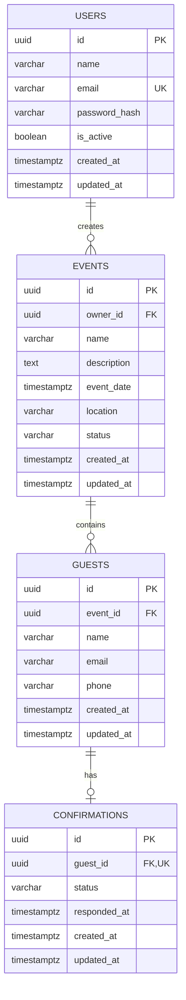

# Modelo de Dados — Inveeti

## 1. Introdução

Este documento define o modelo de dados do Inveeti, descrevendo suas entidades, atributos, relacionamentos e restrições de integridade.

O banco de dados utilizado será o PostgreSQL, com SQLAlchemy como ORM e Alembic para gerenciamento de migrações.

### 1.1 Objetivos

- Definir as entidades principais do sistema.
- Estabelecer relacionamentos entre entidades.
- Padronizar atributos e tipos de dados.
- Definir restrições de integridade.
- Orientar a implementação dos models SQLAlchemy.
- Manter consistência entre o modelo de dados e as regras de negócio.

## 2. Tecnologias

| Tecnologia | Responsabilidade |
|---|---|
| PostgreSQL | Banco de dados relacional |
| SQLAlchemy | ORM e mapeamento das entidades |
| Alembic | Controle de migrações |

## 3. Convenções de Modelagem

### 3.1 Nomenclatura

- Tabelas: `snake_case`, preferencialmente no plural.
- Colunas: `snake_case`.
- Chaves primárias: `id`.
- Chaves estrangeiras: nome da entidade seguido de `_id`.
- Datas: utilizar nomes que indiquem claramente o significado temporal.

Exemplos:

```text
users
events
guests
confirmations

user_id
event_id
guest_id
created_at
updated_at
```

### 3.2 Identificadores

As entidades principais deverão possuir identificadores únicos.

O tipo definitivo será UUID, utilizando o tipo nativo `UUID` do PostgreSQL.

### 3.3 Datas e horários

- Utilizar `TIMESTAMPTZ` para instantes de tempo.
- Armazenar instantes em UTC.
- Converter para o fuso horário apropriado na apresentação ao usuário.
- Utilizar `DATE` quando a informação representar somente uma data.
- Utilizar `TIME` somente quando a informação representar um horário sem uma data associada.

### 3.4 Auditoria

As entidades principais deverão possuir:

| Campo | Tipo | Descrição |
|---|---|---|
| created_at | TIMESTAMPTZ | Data e horário de criação |
| updated_at | TIMESTAMPTZ | Data e horário da última atualização |

Campos adicionais de auditoria deverão ser introduzidos conforme a necessidade.

## 4. Entidades

O modelo inicial contempla quatro entidades principais:

- User
- Event
- Guest
- Confirmation

### 4.1 User

Representa um usuário autenticado que pode criar e gerenciar eventos.

Tabela: `users`

| Campo | Tipo | Obrigatório | Descrição |
|---|---|---|---|
| id | UUID | Sim | Identificador do usuário |
| name | VARCHAR(150) | Sim | Nome do usuário |
| email | VARCHAR(255) | Sim | E-mail de acesso |
| password_hash | VARCHAR(255) | Não | Hash da senha, quando aplicável |
| is_active | BOOLEAN | Sim | Indica se o usuário está ativo |
| created_at | TIMESTAMPTZ | Sim | Data de criação |
| updated_at | TIMESTAMPTZ | Sim | Data de atualização |

Restrições:

- `id` é a chave primária.
- `email` deve possuir restrição de unicidade.
- `email` deve ser normalizado antes de armazenar.
- `is_active` deverá possuir valor padrão `true`.
- `password_hash` poderá ser nulo quando a autenticação não utilizar senha local.

### 4.2 Event

Representa um evento criado e administrado por um usuário.

Tabela: `events`

| Campo | Tipo | Obrigatório | Descrição |
|---|---|---|---|
| id | UUID | Sim | Identificador do evento |
| owner_id | UUID | Sim | Usuário responsável pelo evento |
| name | VARCHAR(150) | Sim | Nome do evento |
| description | TEXT | Não | Descrição do evento |
| event_date | TIMESTAMPTZ | Sim | Data e horário do evento |
| location | VARCHAR(255) | Não | Local do evento |
| status | VARCHAR(30) | Sim | Estado atual do evento |
| created_at | TIMESTAMPTZ | Sim | Data de criação |
| updated_at | TIMESTAMPTZ | Sim | Data de atualização |

Restrições:

- `id` é a chave primária.
- `owner_id` é uma chave estrangeira para `users.id`.
- `name` é obrigatório.
- `event_date` deverá representar um instante válido.
- `status` deverá aceitar somente valores definidos pelo domínio.
- `status` deverá possuir valor padrão `draft`.

Valores iniciais de `status`:

| Valor | Descrição |
|---|---|
| draft | Evento em preparação |
| published | Evento publicado |
| cancelled | Evento cancelado |
| completed | Evento concluído |

### 4.3 Guest

Representa uma pessoa convidada para participar de um evento.

Tabela: `guests`

| Campo | Tipo | Obrigatório | Descrição |
|---|---|---|---|
| id | UUID | Sim | Identificador do convidado |
| event_id | UUID | Sim | Evento associado |
| name | VARCHAR(150) | Sim | Nome do convidado |
| email | VARCHAR(255) | Não | E-mail do convidado |
| phone | VARCHAR(30) | Não | Telefone do convidado |
| created_at | TIMESTAMPTZ | Sim | Data de criação |
| updated_at | TIMESTAMPTZ | Sim | Data de atualização |

Restrições:

- `id` é a chave primária.
- `event_id` é uma chave estrangeira para `events.id`.
- `name` é obrigatório.
- `email` deverá ser normalizado quando informado.
- Um convidado pertence a um evento.
- Um convidado não precisa possuir uma conta de usuário.
- Não permitir duplicidade de convidados dentro do mesmo evento sem uma regra de negócio que justifique essa duplicidade.

A identificação de duplicidade deverá considerar a regra de negócio definida para o cadastro de convidados. Não assumir que e-mail será sempre obrigatório ou suficiente para identificar uma pessoa.

### 4.4 Confirmation

Representa a resposta de um convidado em relação à sua participação em um evento.

Tabela: `confirmations`

| Campo | Tipo | Obrigatório | Descrição |
|---|---|---|---|
| id | UUID | Sim | Identificador da confirmação |
| guest_id | UUID | Sim | Convidado relacionado |
| status | VARCHAR(30) | Sim | Estado da confirmação |
| responded_at | TIMESTAMPTZ | Não | Data e horário da resposta |
| created_at | TIMESTAMPTZ | Sim | Data de criação |
| updated_at | TIMESTAMPTZ | Sim | Data de atualização |

Restrições:

- `id` é a chave primária.
- `guest_id` é uma chave estrangeira para `guests.id`.
- Um convidado deverá possuir no máximo uma confirmação por evento.
- `status` deverá possuir valor padrão `pending`.
- `responded_at` deverá ser preenchido quando houver uma resposta efetiva.

Valores iniciais de `status`:

| Valor | Descrição |
|---|---|
| pending | Aguardando resposta |
| confirmed | Presença confirmada |
| declined | Presença recusada |

## 5. Relacionamentos

### 5.1 User e Event

Um usuário pode criar vários eventos.

Um evento pertence a um único usuário responsável.

Cardinalidade:

```text
User 1 -------- N Event
```

Relacionamento:

```text
events.owner_id -> users.id
```

### 5.2 Event e Guest

Um evento pode possuir vários convidados.

Um convidado pertence a um único evento.

Cardinalidade:

```text
Event 1 -------- N Guest
```

Relacionamento:

```text
guests.event_id -> events.id
```

### 5.3 Guest e Confirmation

Um convidado pode possuir no máximo uma confirmação.

Uma confirmação pertence a um único convidado.

Cardinalidade:

```text
Guest 1 -------- 0..1 Confirmation
```

Relacionamento:

```text
confirmations.guest_id -> guests.id
```

A restrição de unicidade em `confirmations.guest_id` deverá garantir que não existam múltiplas confirmações para o mesmo convidado.

## 6. Diagrama Entidade-Relacionamento



## 7. Integridade e Restrições

O PostgreSQL deverá garantir a integridade dos dados por meio de chaves primárias, chaves estrangeiras, restrições de unicidade e validações.

### 7.1 Chaves primárias

Todas as entidades principais deverão possuir uma chave primária UUID.

### 7.2 Chaves estrangeiras

Os relacionamentos deverão ser implementados utilizando foreign keys.

### 7.3 Unicidade

Restrições iniciais:

| Tabela | Campo | Regra |
|---|---|---|
| users | email | Único |
| confirmations | guest_id | Único |

Outras restrições poderão ser adicionadas conforme as regras de negócio.

### 7.4 Exclusão de registros

As políticas de exclusão deverão preservar a integridade referencial.

Diretrizes iniciais:

- Um usuário não deverá ser excluído automaticamente enquanto possuir eventos associados.
- A exclusão de um evento deverá considerar seus convidados e confirmações.
- A exclusão de um convidado poderá remover sua confirmação associada.
- Exclusões em cascata deverão ser explícitas e justificadas.

O comportamento definitivo deverá ser definido nas regras de negócio e implementado de forma consistente no banco e na aplicação.

## 8. Índices

Índices deverão ser criados para colunas frequentemente utilizadas em filtros, relacionamentos e consultas.

Índices iniciais sugeridos:

| Tabela | Coluna | Justificativa |
|---|---|---|
| users | email | Busca e autenticação |
| events | owner_id | Listagem de eventos por usuário |
| events | event_date | Consulta e ordenação por data |
| events | status | Filtro por estado |
| guests | event_id | Listagem de convidados por evento |
| confirmations | guest_id | Consulta da confirmação do convidado |

Índices adicionais deverão ser criados com base nos padrões reais de consulta e na análise de desempenho.

## 9. Transações

Operações que envolvam múltiplas alterações relacionadas deverão utilizar transações de banco de dados.

Exemplos:

- Criação de um evento com seus convidados iniciais.
- Exclusão de um evento e seus registros dependentes, quando essa operação for permitida.
- Atualização de dados que exijam consistência entre entidades.

Em caso de falha, a transação deverá ser revertida para evitar estados inconsistentes.

## 10. Migrações

As alterações no esquema do banco deverão ser versionadas utilizando Alembic.

Diretrizes:

- Toda alteração estrutural deverá possuir uma migração.
- Migrações deverão ser revisadas antes da aplicação.
- Migrações aplicadas em ambientes compartilhados não deverão ser reescritas sem um processo controlado.
- Alterações destrutivas deverão considerar compatibilidade com versões anteriores da aplicação.
- O histórico de migrações deverá permanecer versionado no repositório.

## 11. Evolução do Modelo

O modelo inicial deverá atender aos requisitos essenciais do Inveeti, evitando antecipar estruturas que ainda não possuem necessidade funcional.

Novas entidades ou atributos poderão ser adicionados conforme a evolução das funcionalidades.

Possíveis evoluções:

- Categorias de eventos.
- Convites individuais com tokens de acesso.
- Histórico de alterações nas confirmações.
- Controle de acompanhantes.
- Limites de capacidade por evento.
- Configurações de prazo para confirmação.
- Auditoria de operações administrativas.

A inclusão dessas estruturas deverá ser precedida por requisitos definidos nas respectivas especificações.

## 12. Referências

- `docs/ARCHITECTURE.md` — Arquitetura geral do sistema.
- `docs/API.md` — Contratos e convenções da API.
- `docs/SECURITY.md` — Diretrizes de segurança.
- `docs/TESTING.md` — Estratégia de testes.
- `specs/` — Requisitos e regras de negócio por funcionalidade.

Documentação oficial:

- PostgreSQL: https://www.postgresql.org/docs/
- SQLAlchemy: https://docs.sqlalchemy.org/
- Alembic: https://alembic.sqlalchemy.org/